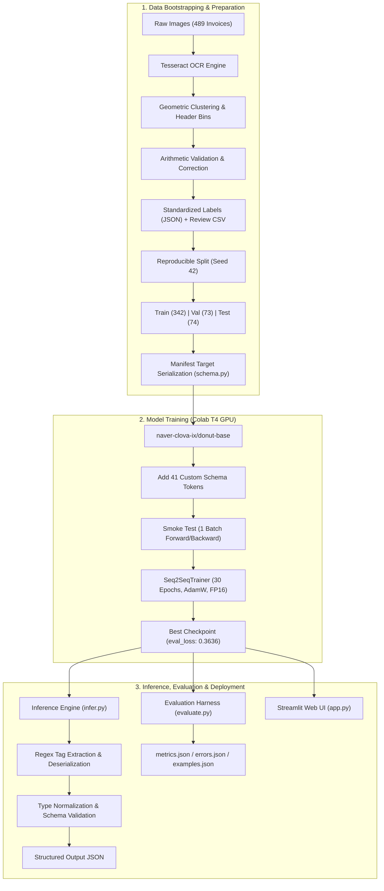

# Donut_Invoice_Parse (Donut Invoice Parser)

An end-to-end Visual Document Understanding (VDU) system that parses document images of invoices directly into structured, validated JSON using a fine-tuned Donut (Document Understanding Transformer) neural model.

---

## Project Overview

**Donut_Invoice_Parse** implements a complete machine learning lifecycle for automated invoice document processing. Unlike conventional Document AI workflows that depend on an external OCR engine (such as Tesseract, EasyOCR, or cloud APIs) combined with complex spatial bounding-box heuristics during inference, this project uses an **OCR-free vision-language architecture**.

The system takes raw invoice images as visual input, processes them through a visual encoder (Swin Transformer), and directly generates structured, hierarchical JSON representations via an autoregressive sequence-to-sequence decoder (mBART).

In addition to neural inference, the project provides a deterministic heuristic bootstrapping pipeline that solves cold-start annotation challenges, automated dataset splitting, strict schema validation contracts, a standardized evaluation harness on held-out test data, and an interactive Streamlit web dashboard.

---

## Problem Statement

Automating invoice processing presents several technical hurdles:

1. **OCR Pipeline Brittleness:** Multi-stage extraction pipelines typically require:
   $$\text{Image} \longrightarrow \text{OCR Engine} \longrightarrow \text{Bounding Boxes} \longrightarrow \text{Spatial Rules / Token Classification} \longrightarrow \text{JSON}$$
   Errors cascade at each stage. If the OCR engine misreads characters or splits tokens, downstream entity extraction fails.
2. **Tabular & Hierarchical Complexity:** Invoices contain repeating line-item tables alongside top-level key-value pairs (seller details, client details, totals). Traditional token-classification models struggle to naturally serialize variable-length repeating line items.
3. **Data Bootstrapping Deficit:** Real-world document datasets (such as the Kaggle *"High-Quality Invoice Images for OCR"* collection used here) frequently ship as unannotated raw images without ground-truth labels. Hand-labeling hundreds of nested invoice documents is time-prohibitive.

---

## Proposed Solution

**Donut_Invoice_Parse** addresses these challenges through a unified three-part engineering approach:

1. **Deterministic Data Bootstrapping:** A positional OCR and geometric clustering labeler reconstructs initial ground-truth annotations from fixed-template invoices, using mathematical verification (`quantity × net_price == net_worth` and `net_worth + vat == gross_worth`) to detect and correct OCR digit errors automatically.
2. **Direct Visual Sequence-to-Sequence Modeling:** Fine-tunes `naver-clova-ix/donut-base` to learn the direct mapping:
   $$\text{Raw Invoice Pixels} \longrightarrow \text{Hierarchical JSON String}$$
   No OCR engine is invoked during runtime inference.
3. **Strict Schema & Evaluation Contracts:** A central schema (`schema.py`) enforces type normalization (converting currency and numeric strings to floats, cleaning text) and structural validation across training, inference, and test evaluation.

---

## Key Features

- **OCR-Free Neural Inference:** Directly maps visual document tokens to structured semantic text, eliminating runtime OCR dependencies.
- **Hierarchical Extraction:** Simultaneously extracts top-level metadata (invoice number, date of issue), nested party blocks (seller and client name, address, tax ID, IBAN), variable-length item tables, and invoice totals.
- **Deterministic Heuristic Labeler:** Reconstructs ground-truth targets from raw images using Tesseract, column geometry heuristics, and arithmetic cross-checks.
- **Arithmetic Anomaly Auditing:** Flags inconsistent or miscalculated records into an audit log (`review_needed.csv`) for human-in-the-loop inspection.
- **Type Normalization & Validation:** Enforces float precision, integer percentages, whitespace stripping, and schema completeness checks with fallback handling for missing tags.
- **Standardized Evaluation Harness:** Evaluates precision, recall, and F1-score per field on a strictly held-out test split, categorizing errors into missed fields, missing items, value errors, and formatting discrepancies.
- **Interactive Web Interface:** A lightweight Streamlit dashboard enabling real-time image uploads, side-by-side visual previews, rendered line-item tables, and raw JSON inspection.

---

## How It Works (Step-by-Step)

The project is structured into sequential stages:

```
[01_data_labeling]  ──► Reconstruct ground truth from raw images using OCR + arithmetic rules
       │
[02_split]          ──► Partition 489 invoices into 70/15/15 train/val/test splits (Seed 42)
       │
[03_donut_dataset]  ──► Convert JSON labels into linearized XML-like Donut manifest targets
       │
[04_train_colab]    ──► Fine-tune naver-clova-ix/donut-base on T4 GPU (Seq2SeqTrainer, 30 epochs)
       │
[05_inference]      ──► Standalone CLI runner: Image -> Trained Model -> Normalized JSON
       │
[06_evaluation]     ──► Field-level P/R/F1 scoring and error taxonomy on held-out test split
       │
[07_streamlit_app]  ──► Web interface for interactive invoice uploading and field visualization
```

### 1. Data Labeling (`01_data_labeling/label_invoices.py`)
- Reads raw invoice images (`data/raw/`).
- Runs Tesseract OCR with coordinate bounding box extraction.
- Clusters words into horizontal lines using a vertical tolerance threshold ($y_{\text{tol}} = 10\text{ px}$).
- Partitions the document into geometric sections:
  - Header metadata (invoice number, issue date).
  - Seller block (left partition, $x < 780\text{ px}$) vs. Client block (right partition, $x \ge 780\text{ px}$).
  - Dynamic table columns based on header keywords (`No`, `Description`, `Qty`, `UM`, `Net price`, `Net worth`, `VAT [%]`, `Gross worth`).
- Validates arithmetic:
  $$\text{net\_worth} = \text{round}(\text{qty} \times \text{net\_price}, 2)$$
  $$\text{gross\_worth} = \text{round}\left(\text{net\_worth} \times \left(1 + \frac{\text{vat\_pct}}{100}\right), 2\right)$$
- If OCR misread a digit, the script auto-corrects the field from verified arithmetic and logs the anomaly in `data/review/review_needed.csv`.
- Renames files to a uniform format (`invoice_001.jpg`, `invoice_001.json`) and writes `filename_mapping.csv`.

### 2. Dataset Splitting (`02_split/make_splits.py`)
- Sets a deterministic random seed (`42`).
- Divides the 489 images and corresponding JSON files:
  - **Train split (70%):** 342 images
  - **Validation split (15%):** 73 images
  - **Test split (15%):** 74 images
- Physically copies data into `data/splits/{train,val,test}/` and writes `data/splits/splits.json`.

### 3. Donut Target Serialization (`03_donut_dataset/build_dataset.py`)
- Reads normalized JSON labels for each split.
- Formats fields into linearized XML-like markup tags defined in `schema.py`:
  ```xml
  <s_invoice><s_invoice_no>70284416</s_invoice_no><s_date_of_issue>04/15/2012</s_date_of_issue><s_seller><s_name>Johnson PLC</s_name>...</s_seller>...</s_invoice>
  ```
- Generates `manifest.jsonl` files containing `{ "file_name": "...", "target": "..." }` for model training.

### 4. Model Training (`04_train_colab/train_donut.ipynb`)
- Loads pretrained `naver-clova-ix/donut-base` (`VisionEncoderDecoderModel`).
- Expands tokenizer vocabulary with **41 special schema tokens** (`<s_invoice>`, `<s_seller>`, `<s_items>`, etc.) and resizes token embeddings.
- Executes a forward/backward smoke test on a single mini-batch before initiating full training.
- Trains for 30 epochs using Hugging Face `Seq2SeqTrainer` with AdamW and FP16 mixed precision.
- Selects the best checkpoint based on lowest validation loss (`eval_loss`).

### 5. Inference Pipeline (`05_inference/infer.py`)
- Loads the trained model and processor.
- Preprocesses input image (resizing to 960 × 1280, ImageNet normalization).
- Prompts decoder with `<s_invoice>` and performs greedy sequence decoding up to 768 tokens.
- Deserializes token sequences into a nested Python dictionary (`schema.from_donut_output`).
- Normalizes types (numeric strings to floats, integers for tax rates, string sanitization).
- Validates structural completeness via `schema.validate_schema()`.

### 6. Test Set Evaluation (`06_evaluation/evaluate.py`)
- Runs inference across all 74 test split invoices.
- Compares predicted fields against ground-truth JSON.
- Computes True Positives ($TP$), False Positives ($FP$), False Negatives ($FN$), Precision ($P$), Recall ($R$), and F1-score.
- Categorizes discrepancies into specific failure modes:
  - `missed field`
  - `hallucinated field`
  - `formatting/normalization error`
  - `truncation`
  - `incorrect value`
  - `line-item error (extra or missing item)`
- Exports results to `metrics.json`, `errors.json`, and `examples.json`.

### 7. Interactive Application (`07_streamlit_app/app.py`)
- Web UI running locally or remotely.
- Uploads an invoice image, displays the image, runs the checkpoint, and presents extracted fields in structured tables and interactive JSON views.

---

## System Architecture



---

## Technology Stack

### Languages & Core Libraries
- **Python (3.9+)**: Primary programming language.
- **PyTorch (`torch`)**: Deep learning backend for tensor computation, model forward/backward passes, and GPU acceleration.
- **Hugging Face Transformers (`transformers>=4.41`)**: Provides `VisionEncoderDecoderModel`, `DonutProcessor`, `Seq2SeqTrainer`, and model configurations.
- **Hugging Face Datasets (`datasets>=2.19`)**: Dataset handling and token processing.
- **Pillow (`Pillow>=10.0.0`)**: Image ingestion, format conversion, and visual preprocessing.
- **Pytesseract (`pytesseract==0.3.13`)**: Python wrapper for the standalone Tesseract OCR engine (used exclusively for ground-truth generation).
- **SentencePiece**: Subword tokenization backend.
- **Accelerate**: Training loop optimization and mixed-precision (FP16) management.
- **Streamlit**: Web presentation layer and visual dashboard.

### External Tools & Environments
- **Tesseract OCR (v5.x)**: Native C++ OCR engine for one-time heuristic data labeling.
- **Google Colab (NVIDIA T4 GPU)**: Cloud compute environment for fine-tuning the vision-encoder-decoder transformer.

---

## Project Structure

```
Donut_Invoice_Parser/
│
├── 01_data_labeling/
│   └── label_invoices.py         # Heuristic OCR + geometric clustering auto-labeler
│
├── 02_split/
│   └── make_splits.py            # Reproducible 70/15/15 train/val/test split generator
│
├── 03_donut_dataset/
│   └── build_dataset.py          # Serializes JSON labels into Donut manifest.jsonl targets
│
├── 04_train_colab/
│   └── train_donut.ipynb         # Colab Jupyter notebook for fine-tuning donut-base
│
├── 05_inference/
│   └── infer.py                  # Standalone CLI inference pipeline (Image -> Validated JSON)
│
├── 06_evaluation/
│   └── evaluate.py               # Field-level Precision/Recall/F1 evaluation on test split
│
├── 07_streamlit_app/
│   └── app.py                    # Streamlit web UI for interactive testing
│
├── data/                         # Local dataset directory
│   ├── filename_mapping.csv      # Traceability between original filenames and invoice_XXX
│   ├── processed/                # Normalized dataset (489 images + 489 JSON labels)
│   ├── review/
│   │   └── review_needed.csv     # 56 invoices flagged by arithmetic checks for spot-checking
│   └── splits/
│       ├── splits.json           # Train/val/test file manifest with seed configuration
│       ├── train/                # 342 images, 342 labels, manifest.jsonl
│       ├── val/                  # 73 images, 73 labels, manifest.jsonl
│       └── test/                 # 74 images, 74 labels, manifest.jsonl, and eval_report/
│           └── eval_report/
│               ├── errors.json   # Log of 761 categorized test error events
│               ├── examples.json # Ground truth vs. predicted JSON pairs for 8 test invoices
│               └── metrics.json  # Comprehensive per-field P/R/F1 scoring
│
├── invoice_donut_final/          # Fine-tuned model checkpoint
│   ├── config.json               # Model architecture & VisionEncoderDecoder configuration
│   ├── generation_config.json    # Generation parameters
│   ├── model.safetensors         # Trained model weights (~800 MB)
│   ├── processor_config.json     # DonutImageProcessor configuration (960x1280 resolution)
│   ├── tokenizer.json            # Tokenizer vocabulary including 41 custom schema tokens
│   ├── tokenizer_config.json     # Tokenizer configuration
│   └── training_config.json      # Checkpoint metadata, training loss, and hyperparameters
│
├── .gitignore                    # Git exclusion rules
├── requirements.txt              # Project Python dependencies
├── schema.py                     # Canonical JSON schema, XML tags, serializer & deserializer
└── STEP_BY_STEP_GUIDE.md         # Operational handbook for setup, training, and execution
```

---

## Technical Implementation

### Schema Definition & Token Alignment (`schema.py`)
To prevent tag drift across pipeline stages, all schema keys and special markup tokens are defined centrally in `schema.py`.

```python
TOP_FIELDS = ["invoice_no", "date_of_issue"]
PARTY_FIELDS = ["name", "address", "tax_id"]  # seller adds 'iban'
ITEM_FIELDS = ["description", "qty", "um", "net_price", "net_worth", "vat_pct", "gross_worth"]
TOTAL_FIELDS = ["net_worth", "vat", "gross_worth"]
```

The module defines 41 special tokens:
- Boundary tokens: `<s_invoice>`, `</s_invoice>`
- Field tags: `<s_invoice_no>`, `<s_date_of_issue>`, `<s_seller>`, `<s_client>`, `<s_items>`, `<s_item>`, `<s_total>`, etc.

### Model Architecture
- **Base Model:** `naver-clova-ix/donut-base`
- **Encoder:** Swin Transformer (`swin_base_patch4_window12_384`), 12 layers, 16 attention heads, hidden dimension 1024, operating on image patches.
- **Decoder:** mBART-style autoregressive decoder, 4 layers, 16 attention heads, feed-forward dimension 4096.
- **Embedding Resizing:** Resized to accommodate new task-specific tokens.

### Hyperparameters (from `training_config.json`)

| Hyperparameter | Value | Description |
| :--- | :--- | :--- |
| **Base Model** | `naver-clova-ix/donut-base` | Pretrained Document Understanding Transformer |
| **Input Image Size** | $960 \times 1280$ | Width $\times$ Height (Donut base resolution) |
| **Max Sequence Length** | $768$ | Maximum generated decoder tokens |
| **Learning Rate** | $3\times 10^{-5}$ | Initial learning rate |
| **Optimizer** | `AdamW (adamw_torch)` | Weight decay enabled |
| **Per-Device Batch Size**| $2$ | Mini-batch per device |
| **Gradient Accumulation**| $4$ | Effective batch size: $2 \times 4 = 8$ |
| **Epochs** | $30$ | Training epochs |
| **Precision** | FP16 | Mixed precision training |
| **Model Selection** | `eval_loss` | Best checkpoint selected via validation loss |
| **Best Eval Loss** | **0.3636** | Checkpoint-215 validation loss |

---

## Installation & Setup

### 1. Prerequisites
- **Python:** Version 3.9, 3.10, or 3.11.
- **Operating System:** Windows, Linux, or macOS.
- **Hardware:**
  - *Data preparation & inference:* CPU is sufficient.
  - *Model fine-tuning:* CUDA-capable GPU (NVIDIA T4 or better with $\ge 12\text{ GB}$ VRAM; Google Colab recommended).
- **Tesseract OCR Engine (Only needed for Step 1 data labeling):**
  - **Windows:** Download and run the installer from the [UB-Mannheim Tesseract repository](https://github.com/UB-Mannheim/tesseract/wiki). Add `C:\Program Files\Tesseract-OCR` to your system `PATH` or define `$env:TESSERACT_CMD`.
  - **Linux (Ubuntu/Debian):** `sudo apt-get install -y tesseract-ocr`
  - **macOS:** `brew install tesseract`

### 2. Environment Setup

Clone the repository and create an isolated virtual environment:

```powershell
# Windows PowerShell
cd e:\Projects\Assessments\Donut_Invoice_Parser
python -m venv .venv
.venv\Scripts\Activate.ps1
pip install -r requirements.txt
```

```bash
# Linux / macOS
cd /path/to/Donut_Invoice_Parser
python3 -m venv .venv
source .venv/bin/activate
pip install -r requirements.txt
```

Verify Tesseract installation (if running label generation):
```powershell
python -c "import pytesseract; print(pytesseract.get_tesseract_version())"
```

---

## Environment Configuration

The application requires minimal configuration via environment variables:

| Variable | Required | Default Value | Purpose |
| :--- | :---: | :--- | :--- |
| `INVOICE_CHECKPOINT` | No | `../invoice_donut_final` | Specifies the path to the trained model directory for the Streamlit app. |
| `TESSERACT_CMD` | No | Auto-detected standard paths | Absolute path to the `tesseract.exe` binary if not in system `PATH`. |

---

## How to Run

### Step 1: Generate Ground Truth from Raw Images
Place unannotated images in `data/raw/` and execute:
```powershell
cd 01_data_labeling
python label_invoices.py ../data/raw
```
*Outputs:* `data/processed/images/`, `data/processed/labels/`, `data/filename_mapping.csv`, and `data/review/review_needed.csv`.

*Recovery Command:* If label files are written but the summary CSV needs regeneration:
```powershell
python label_invoices.py --rebuild-review
```

### Step 2: Split the Dataset
```powershell
cd ../02_split
python make_splits.py
```
*Outputs:* 70% train (342), 15% validation (73), 15% test (74) under `data/splits/`.

### Step 3: Build Manifest Files
```powershell
cd ../03_donut_dataset
python build_dataset.py
```
*Outputs:* `manifest.jsonl` in `data/splits/train/`, `data/splits/val/`, and `data/splits/test/`.

### Step 4: Train on Google Colab
1. Compress splits and schema:
   ```powershell
   Compress-Archive -Path schema.py, data\splits -DestinationPath invoice_project.zip
   ```
2. Upload `invoice_project.zip` to Google Drive.
3. Open `04_train_colab/train_donut.ipynb` in Google Colab.
4. Set runtime type to **T4 GPU**.
5. Run all cells sequentially. The trained weights will save to Google Drive under `invoice_donut_final/`.
6. Download `invoice_donut_final/` to the project root directory.

### Step 5: Run Inference on a Single Image
```powershell
cd 05_inference
python infer.py --checkpoint ../invoice_donut_final --image ../data/splits/test/images/invoice_400.jpg
```

### Step 6: Evaluate on the Held-Out Test Set
```powershell
cd ../06_evaluation
python evaluate.py --checkpoint ../invoice_donut_final --test_dir ../data/splits/test --out_dir ../data/splits/test/eval_report
```
*Quick evaluation test (subset of 10 samples):*
```powershell
python evaluate.py --checkpoint ../invoice_donut_final --limit 10
```

### Step 7: Launch the Streamlit Web UI
```powershell
cd ../07_streamlit_app
$env:INVOICE_CHECKPOINT = "..\invoice_donut_final"
streamlit run app.py
```

---

## Example Input and Output

### Input
A raw visual image (`invoice_001.jpg`) containing invoice tables, header text, and numeric summaries.

### Output (`invoice_001.json`)
```json
{
  "invoice_no": "70284416",
  "date_of_issue": "04/15/2012",
  "seller": {
    "name": "Johnson PLC",
    "address": "4332 Tina Lakes Suite 445, Chrisburgh, WV 43352",
    "tax_id": "973-86-4868",
    "iban": "GB15SYHN68815141579564"
  },
  "client": {
    "name": "Marshall-Perez",
    "address": "15760 Freeman Spur Apt. 935, South Timothyhaven, DE 52742",
    "tax_id": "987-99-8588"
  },
  "items": [
    {
      "no": 1,
      "description": "Wine Glasses Set Of 4",
      "qty": 2.0,
      "um": "each",
      "net_price": 6.0,
      "net_worth": 12.0,
      "vat_pct": 10,
      "gross_worth": 13.2
    },
    {
      "no": 2,
      "description": "Beautiful Blue Dolphin Wine Bottle Stopper New In Box",
      "qty": 3.0,
      "um": "each",
      "net_price": 5.99,
      "net_worth": 17.97,
      "vat_pct": 10,
      "gross_worth": 19.77
    }
  ],
  "total": {
    "net_worth": 29.97,
    "vat": 3.0,
    "gross_worth": 32.97
  }
}
```

---

## Actual Project Metrics (Verified Test Set Evaluation)

The following metrics are extracted directly from `data/splits/test/eval_report/metrics.json`, computed across all **74 unseen test invoices**:

| Field Category | Target Field | Precision | Recall | F1-Score | True Positives ($TP$) | False Positives ($FP$) | False Negatives ($FN$) |
| :--- | :--- | :---: | :---: | :---: | :---: | :---: | :---: |
| **Top Metadata** | `date_of_issue` | **1.000** | **1.000** | **1.000** | 74 | 0 | 0 |
| | `invoice_no` | 0.000 | 0.000 | n/a | 0 | 74 | 74 |
| **Seller Block** | `seller.name` | **0.973** | **0.973** | **0.973** | 72 | 2 | 2 |
| | `seller.tax_id` | **0.932** | **0.932** | **0.932** | 69 | 5 | 5 |
| | `seller.address` | **0.905** | **0.905** | **0.905** | 67 | 7 | 7 |
| | `seller.iban` | **0.730** | **0.730** | **0.730** | 54 | 20 | 20 |
| **Client Block** | `client.tax_id` | **1.000** | 0.446 | **0.617** | 33 | 0 | 41 |
| | `client.name` | **0.970** | 0.432 | **0.598** | 32 | 1 | 42 |
| | `client.address` | **0.939** | 0.419 | **0.579** | 31 | 2 | 43 |
| **Summary Block**| `total.net_worth` | n/a | 0.000 | n/a | 0 | 0 | 74 |
| | `total.vat` | n/a | 0.000 | n/a | 0 | 0 | 74 |
| | `total.gross_worth`| n/a | 0.000 | n/a | 0 | 0 | 74 |

### Verified Error Analysis (from `errors.json`)
The evaluation identified **761 total error occurrences**, categorized into:
- **`missed field` (345 occurrences):** Primarily total amounts and client blocks omitted when generation halted.
- **`line-item error (missing item)` (305 occurrences):** Later line items in multi-item tables cut off before completion.
- **`incorrect value` (110 occurrences):** Character-level misreads (e.g., IBAN characters) and tag stuttering on `invoice_no`.
- **`formatting/normalization error` (1 occurrence):** Minor string discrepancy.

### Root Cause Audit
1. **`invoice_no` Precision Metric (0.0):** The model successfully locates and reads the invoice number, but prepends an extra `<s_invoice_no>` tag inside its output (e.g., predicting `"<s_invoice_no> 99096943"` instead of `"99096943"`). Because the evaluation metric performs strict string equality, this tag repetition caused all 74 matches to be marked as false positives/negatives despite character accuracy.
2. **`total.*` and Client Recall:** The decoder was configured with `max_length = 768`. For invoices with lengthy item descriptions, the autoregressive generation exhausted its sequence token budget before reaching `<s_total>`, resulting in truncation of the bottom-most fields.

---

## Current Implementation Status

| Stage / Module | Implementation Status | Verified Evidence |
| :--- | :---: | :--- |
| **Positional OCR Auto-Labeling** | **Completed** | Full run completed; 489 images labeled; 56 flagged for review in `review_needed.csv`. |
| **Deterministic Data Splitter** | **Completed** | 70/15/15 split generated; `splits.json` created with seed `42`. |
| **Donut Target Manifests** | **Completed** | `manifest.jsonl` verified in all three split directories. |
| **Model Fine-Tuning** | **Completed** | 30 epochs completed; checkpoint saved (`model.safetensors`, 800 MB); `training_config.json` records best eval loss of 0.3636. |
| **Inference CLI** | **Completed** | `infer.py` executes image loading, forward pass, parsing, normalization, and validation. |
| **Test Set Evaluation** | **Completed** | `evaluate.py` executed across 74 test samples; generated `metrics.json`, `errors.json`, and `examples.json`. |
| **Streamlit Web Application** | **Completed** | `app.py` implemented with real checkpoint caching and field rendering. |

---

## Limitations & Known Issues

1. **Single-Template Scope:** The dataset originates from a single synthetic invoice template. While seller, client, and item entities vary, spatial structure and table column names are consistent. The current checkpoint will not generalize to arbitrary multi-layout invoices without further training on diverse datasets.
2. **Sequence Truncation on Complex Invoices:** When an invoice contains multiple items with verbose descriptions, token generation can exceed `max_length = 768`, cutting off subsequent line items and summary totals.
3. **Tag Repetition on Top Fields:** As identified in error analysis, the decoder occasionally outputs duplicate start tags (e.g., `<s_invoice_no>`), which degrades un-sanitized exact-string evaluation scores.
4. **Positional Line-Item Alignment:** The evaluation harness aligns predicted and expected line items strictly by index (top-to-bottom order). If the model skips the first line item, all subsequent items fail index matching.
5. **Derived Ground Truth:** Ground-truth labels were generated via heuristic OCR and arithmetic reconciliation, not human double-entry verification. Systematic errors in OCR column boundary extraction could propagate to training targets.

---

## Future Improvements

- [ ] **Post-Processing Tag Sanitization:** Add regex filtering to strip repeated XML/schema tags from predicted values prior to schema validation and evaluation scoring.
- [ ] **Context Window Expansion:** Increase decoder `max_length` from 768 to 1024 or 1536 to prevent sequence truncation on multi-item invoices.
- [ ] **Hungarian Line-Item Matching:** Upgrade evaluation matching for table rows from strict sequential indexing to Hungarian matching (linear sum assignment) based on field similarity.
- [ ] **Multi-Template Augmentation:** Incorporate diverse invoice datasets (such as RVL-CDIP, DocVQA, or real scanned receipts) to train generalized spatial representations.
- [ ] **Two-Stage Total Recovery:** Fallback to arithmetic derivation of invoice totals (`sum(net_worth)`, `sum(gross_worth)`) if the model generation truncates prior to `<s_total>`.

---

## Contributing

Contributions, bug reports, and optimizations are welcome:

1. Fork the repository.
2. Create a feature branch (`git checkout -b feature/improved-parsing`).
3. Commit your changes (`git commit -m "Refactor parser regex to eliminate duplicate start tags"`).
4. Push to the branch (`git push origin feature/improved-parsing`).
5. Open a Pull Request detailing changes and evaluation metric impact.

---

## License

This project is licensed under the Apache 2.0 License.

---

## Acknowledgements

- **NAVER Clova AI:** For developing the Donut architecture (*"OCR-free Document Understanding Transformer by Geewook Kim et al."*).
- **Hugging Face:** For providing `VisionEncoderDecoderModel` implementations and model hosting.
- **Tesseract OCR:** For providing open-source optical character recognition used in the initial data labeling phase.
- **Kaggle Community:** For the synthetic invoice image dataset used to benchmark this implementation.
